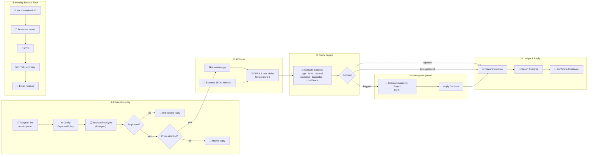

# AI Expense Receipt Assistant

**Expense reports without the reports.** Employees snap a photo of a receipt in Telegram. An AI vision model reads it and a policy engine checks it against company rules. Managers approve flagged spend with one tap, and finance gets a clean month-end pack automatically.


---

## Executive Overview

Employee expenses are among the most disliked processes in any company. Receipts get lost, spreadsheets are filled in weeks late, managers rubber-stamp what they can't check, and finance chases everyone at month-end.

This assistant moves the whole process into a chat app employees already use:

| Stage | What happens | Business control |
|---|---|---|
| **① Intake & Identity** | Employee sends a receipt photo (with an optional caption) to the company Telegram bot | Only registered, active employees can submit; others get a polite onboarding message |
| **② AI Vision** | An OpenAI vision model reads the photo directly into a **schema-locked expense record** | Values not printed on the receipt become `null`. The model never guesses |
| **③ Policy Engine** | Receipt age, per-category limits, auto-approve ceiling, alcohol, weekend spend, duplicates, AI confidence | Policy is configuration and is applied the same way every time |
| **④ Manager Approval** | Flagged expenses go to the employee's manager with **Approve / Reject** buttons | Clear approval chain with a 72 h timeout escalation status |
| **⑤ Ledger & Reply** | Idempotent upsert into PostgreSQL; the employee gets an instant confirmation or rejection reason | Full audit trail: original Telegram file ID, flags, decision, execution ID |
| **⑥ Monthly Finance Pack** | On the 1st, finance receives an HTML summary by department and category with a CSV attached | Month-end close without chasing anyone |

### How it differs from AP invoice automation

This repo targets **employee spend** (T&E, meals, fuel, small purchases), not supplier invoices. It is mobile-first, enforces policy per employee, and routes approvals through managers rather than accounts payable.

### Policy rules out of the box

| Rule | Type | Default |
|---|---|---|
| Not a receipt / illegible / no total / no date | ❌ Reject | always |
| Older than `maxReceiptAgeDays` or future-dated | ❌ Reject | 90 days |
| Same employee + merchant + date + amount already filed | ❌ Reject | always |
| Over category limit (e.g. Meals $75, Lodging $350) | 🟡 Manager | configurable map |
| At or above `autoApproveLimit` | 🟡 Manager | $250 |
| Contains alcohol | 🟡 Manager | always |
| Weekend purchase | 🟡 Manager | always |
| AI confidence below threshold / items don't reconcile | 🟡 Manager | 0.80 |
| Everything else | ✅ Auto-approve | n/a |

### Business ROI

> Illustrative model for a 200-employee company. Replace the inputs with your own numbers.

| Metric | Spreadsheet + email process | With the assistant |
|---|---|---|
| Employee time per expense report | ~20 min / month | ~10 sec per receipt |
| Finance processing per receipt | ~5 min | Exceptions only |
| Lost or late receipts | Common | Captured at point of purchase |
| Policy violations caught | Spot checks | 100% of receipts screened |
| Month-end expense close | Days of chasing | Report arrives on the 1st |

**Value drivers:** about 60+ employee hours back each month, finance focused on exceptions, fewer out-of-policy reimbursements, and no duplicate claims.

---

## Architecture



---

## Repository Structure

```
├── workflows/
│   └── expense_receipt_assistant.json   # Import this into n8n
├── db/
│   └── schema.sql                       # employees + expenses tables
├── .env.example                         # Credential & policy checklist
├── .gitignore
├── LICENSE
└── README.md
```

---

## Setup & n8n Import

### Prerequisites

- n8n **1.90+** on a **public HTTPS URL** (Telegram webhooks require it)
- PostgreSQL 13+
- Telegram bot token from [@BotFather](https://t.me/BotFather)
- [OpenAI API key](https://platform.openai.com/api-keys) with access to a vision-capable model
- Gmail account for the monthly report

### Step 1: Database

```bash
psql "$DATABASE_URL" -f db/schema.sql
```

Register employees, mapping each person's Telegram user ID to their profile and manager:

```sql
INSERT INTO employees (full_name, email, department, cost_center, telegram_user_id, manager_telegram_chat_id)
VALUES ('Jane Doe', 'jane@yourcompany.com', 'Sales', 'CC-200', 123456789, 987654321);
```

> Tip: unregistered users who message the bot are told their Telegram ID, so they can send it to finance.

### Step 2: Import the workflow

1. In n8n, open **Workflows → Add workflow → ⋯ → Import from File**.
2. Select `workflows/expense_receipt_assistant.json`.

### Step 3: Credentials

| Credential name | n8n type | Used by |
|---|---|---|
| `Expense Assistant · Telegram Bot` | Telegram API | Trigger, replies, approvals |
| `Expense Assistant · OpenAI API` | OpenAI | Vision model |
| `Expense Assistant · Postgres` | Postgres | Employee lookup, ledger, report |
| `Expense Assistant · Gmail (Finance)` | Gmail OAuth2 | Monthly report |

### Step 4: Configure the policy

Edit **`Config · Expense Policy`**:

| Setting | Default | Purpose |
|---|---|---|
| `baseCurrency` | `USD` | Fallback when the receipt shows no currency |
| `autoApproveLimit` | `250` | At or above this, manager approval is required |
| `maxReceiptAgeDays` | `90` | Older receipts are rejected |
| `confidenceThreshold` | `0.8` | Below this, the expense is flagged for the manager |
| `categoryLimits` | JSON map | Per-category ceilings (Meals 75, Lodging 350, …) |
| `financeApproverChatId` | placeholder | Fallback approver when an employee has no manager |

Set the report recipient in **`Report · Email Finance Pack`**.

### Step 5: Activate

Toggle the workflow **Active**. n8n registers the Telegram webhook automatically. Send the bot a receipt photo to test.

### Customising

- **Slack / WhatsApp / MS Teams** instead of Telegram: swap the trigger and reply nodes. The policy engine doesn't depend on the channel.
- **Multi-currency:** add an FX-rate HTTP node before the policy engine and compare limits in base currency.
- **Payroll / ERP export:** add an HTTP node after the Postgres upsert to push approved expenses to Expensify, SAP Concur, Xero or your payroll provider.

---

## 🎬 2-Minute Client Demo Script

> **Before the call:** phone mirrored on screen with the Telegram bot open, a second Telegram account as "Manager", n8n canvas and a Postgres viewer (or the last report email) in tabs. Have three real receipts ready: (A) a $18 coffee, (B) a $140 team dinner that includes wine, (C) a photo of receipt A again.

| Time | On screen | What you say |
|---|---|---|
| **0:00 – 0:15** | Title → phone screen with Telegram | "Nobody likes expense reports. So what if there weren't any? Your team just takes a photo of the receipt." |
| **0:15 – 0:35** | Send receipt **A** → reply in ~5 seconds: ✅ approved, merchant, amount, category | "That's it. The AI read the merchant, date, amount and category. It's under policy, so it's approved and filed. The employee is done before they've left the café." |
| **0:35 – 0:50** | Flip to n8n canvas; click the AI node output, then the Policy node | "Behind the scenes, a vision model extracts a strict, structured record, and a policy engine checks your rules: receipt age, category limits, duplicates and more." |
| **0:50 – 1:15** | Send receipt **B** → manager phone shows Approve / Reject with flags (*over meals limit*, *contains alcohol*) → tap Approve → employee gets ✅ | "The team dinner is over the $75 meals limit and includes wine. Instead of being silently paid, it goes to the manager with the reasons attached. One tap, approved, and the employee is notified." |
| **1:15 – 1:30** | Send receipt **C** → ❌ "already submitted" | "Same receipt again, whether by accident or not. It's caught instantly. No duplicate reimbursements." |
| **1:30 – 1:45** | Show the monthly report email: department and category tables, CSV attachment | "On the first of every month, finance gets this automatically: spend by department and category, plus the line-level CSV for payroll." |
| **1:45 – 2:00** | Config node → back to phone | "Limits, thresholds and approvers are all configurable, and it works on Slack or Teams too. Shall we pilot it with one department next month?" |

---

## Security & Privacy

- No secrets in the workflow JSON; credentials live in n8n's encrypted store.
- Only employees in the `employees` table can submit expenses.
- Receipt text is treated as untrusted input (prompt-injection hardening in the system prompt).
- Receipt photos stay in Telegram; only the `file_id` is stored. Add a Drive or S3 upload node if your retention policy requires copies.

## License

[MIT](LICENSE)
